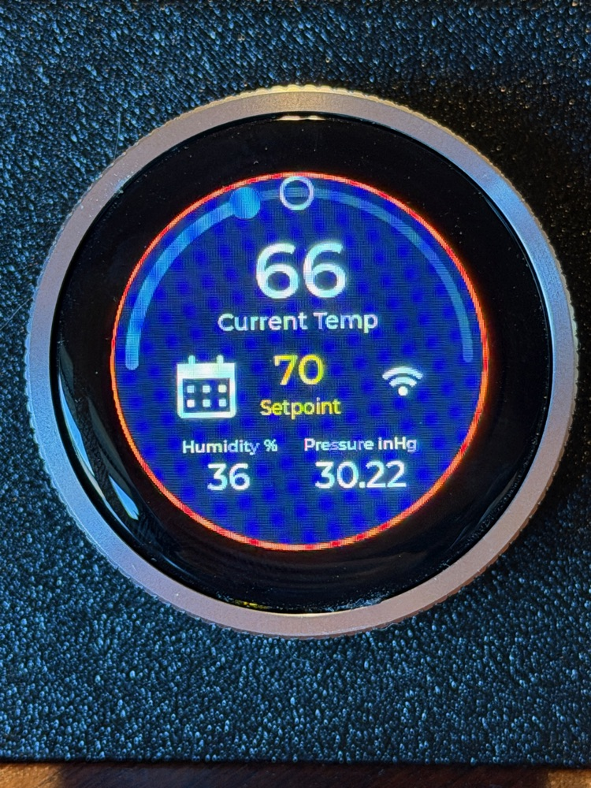
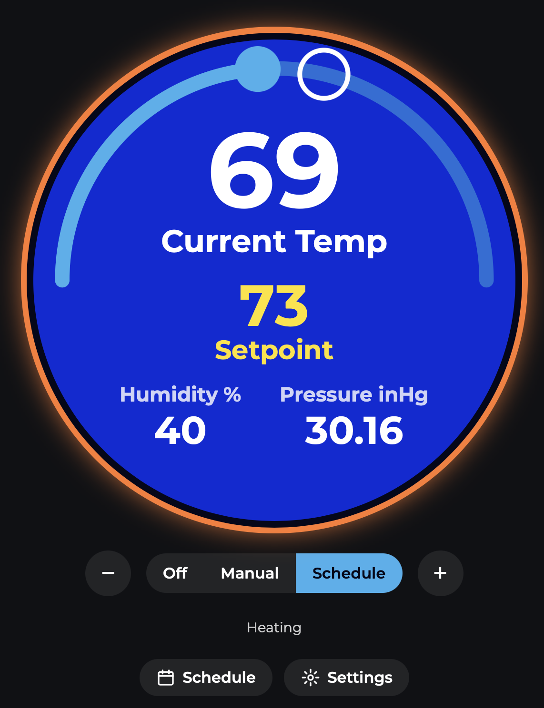
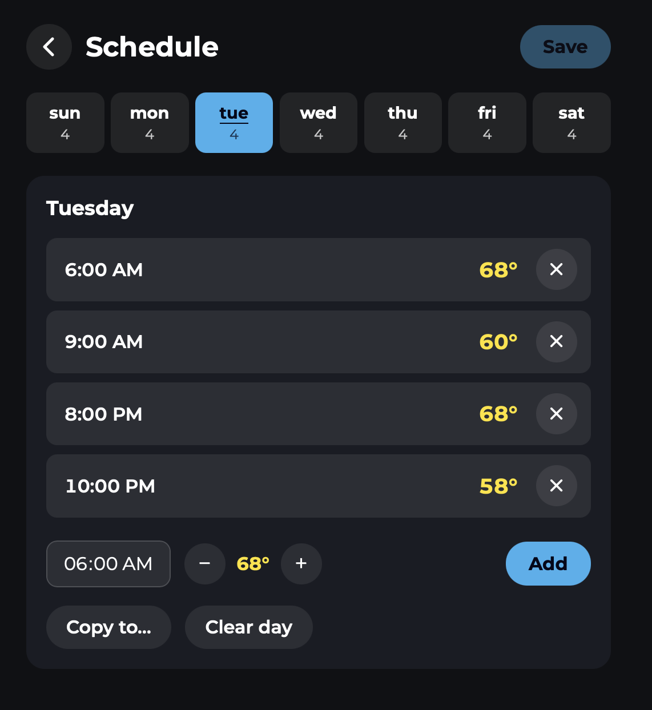
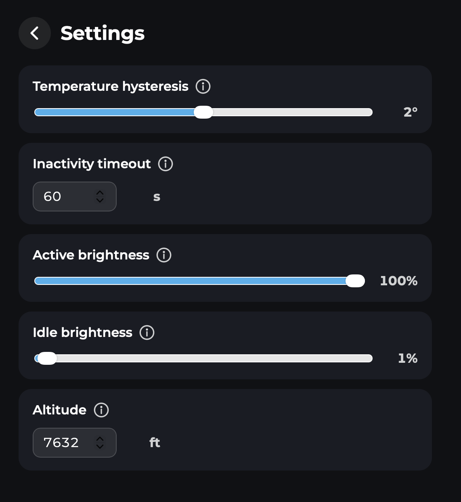

# Thermostat

A WiFi-connected heating thermostat for the ESP32-S3, built around a round touch display with a rotary encoder, specifically the Elecrow CrowPanel 1.28inch-HMI ESP32 Rotary Display. It reads temperature, humidity and pressure from a BME280, calls for heat when the room is below the setpoint, and tells a remote heater unit what to do over ESP-NOW (or switches a relay directly). A React web app served by the device itself gives you the same controls, plus a weekly schedule and settings, from any browser on your network.

<p align="center">
  
</p>

## Features

- **Three modes**: Off, Manual, and Schedule.
- **Local control**: turn the ring to change the setpoint (50-90 °F), tap the mode icon to cycle modes.
- **Weekly schedule**: up to 6 setpoint changes per day, for each of the 7 days. Set it from the web app.
- **Web app**: live status, setpoint and mode control, schedule editor and settings, served from the device.
- **REST API**: everything the web app does is available as JSON, for scripting or home automation.
- **Heater control**: wireless over ESP-NOW with automatic pairing, and/or an optional local relay.
- **Sensors**: temperature, humidity, and barometric pressure corrected to sea level for your altitude.
- **WiFi setup by captive portal**: no credentials in the source. NTP sets the clock for the schedule.
- **Idle screen**: dims after a configurable timeout (or never, if set to 0); the first touch or ring turn just wakes it.
- **Persistent**: mode, setpoint, schedule and settings are stored in NVS and survive power loss.

## Hardware

| Part | Notes |
| --- | --- |
| Elecrow CrowPanel 1.28" Rotary Display | ESP32-S3, 16 MB flash, octal PSRAM, 240x240 GC9A01 round LCD, CST816S touch, rotary encoder with push switch, NeoPixel ring |
| BME280 breakout | I2C at address 0x76 |
| Remote heater unit (optional) | Any ESP32 running a matching ESP-NOW receiver ([remote unit repo](TODO-REMOTE-REPO-URL)) |
| Relay board (optional) | See [Optional local heater relay](#optional-local-heater-relay) |

Pin assignments, as used in the firmware:

| Function | GPIO |
| --- | --- |
| LCD SCLK / MOSI / CS / DC / RST | 10 / 11 / 9 / 3 / 14 |
| LCD backlight (PWM) | 46 |
| Touch SDA / SCL / RST / INT | 6 / 7 / 13 / 5 |
| Encoder A / B / switch | 45 / 42 / 41 |
| BME280 SDA / SCL | 38 / 39 |
| NeoPixels | 48 |
| Local relay (optional) | 44 |

## Using the thermostat

### On the device

- **Turn the ring** to raise or lower the setpoint. The new value takes effect about 2.5 seconds after you stop turning.
- **Tap the mode icon** to cycle Off, Manual and Schedule. The change is applied after the same short delay, so you can pass through modes without toggling the heater.
- The **WiFi symbol** shows when the device is connected. A separate screen shows its IP address.
- After the inactivity timeout the screen dims to the idle screen. Touch or turn the ring to wake it. Set the timeout to 0 to keep the screen on.

### Modes

| Mode | Behaviour |
| --- | --- |
| Off | Heater is never called. |
| Manual | Holds the setpoint you choose. |
| Schedule | Applies the most recent event of the current day when entered, and again at each new event. A setpoint you change by hand stays in place until the next event. Nothing happens until the clock has synced. |

### Heater logic

With hysteresis `h`, the heater turns **on** when `temperature + h <= setpoint` and **off** when `temperature >= setpoint + h`. A larger hysteresis means fewer, longer heating cycles.

## Web app

Open `http://<device-ip>` (the IP is on the device's network screen), or `http://thermostat.local` if your network resolves it. There is no authentication, so keep the device on a trusted network.

<table>
  <tr>
    <td align="center"><br><b>Main</b></td>
    <td align="center"><br><b>Schedule</b></td>
    <td align="center"><br><b>Settings</b></td>
  </tr>
</table>

- **Main**: current temperature, setpoint, humidity, pressure, heating status, mode selector and setpoint buttons.
- **Schedule**: pick a day, add or remove events (time and setpoint), copy a day to others, clear a day. Edits are held in memory until you press **Save**.
- **Settings**:

| Setting | Range | Purpose |
| --- | --- | --- |
| Temperature hysteresis | 0-4 °F | Slack before the heater switches on or off |
| Inactivity timeout | 0-3600 s | Time before the idle screen takes over; 0 never times out |
| Active brightness | 1-100 % | Backlight while the screen is in use |
| Idle brightness | 0-100 % | Backlight while the idle screen shows |
| Altitude | -1500 to 20000 ft | Corrects the pressure reading to sea level, to match weather reports |

## Getting started

### Requirements

- [ESP-IDF](https://docs.espressif.com/projects/esp-idf/en/latest/esp32s3/get-started/) 6.1 (the version the project is configured with; the component manifest accepts 5.0 and later)
- Node.js and npm, for the web app. The build runs `npm install` and `npm run build` for you.

### Build and flash

```bash
idf.py set-target esp32s3
idf.py build flash monitor
```

The build compiles `web/` and packs the result into the `www` SPIFFS partition, which is flashed along with the firmware. The first build downloads the managed components (LVGL port, EEZ framework, WiFi provisioner and others).

### Connect to WiFi

1. On first boot the device starts an access point named **Thermostat-Setup**.
2. Join it from a phone or computer. A captive portal opens, where you pick your network and enter its password.
3. The device reboots into your network. Its IP address appears on the network screen, and the WiFi symbol shows on the main screen.

To start over, uncomment `THERMOSTAT_WIFI_RESET` in `main/thermostat_config.h`, flash once to erase the saved credentials, then comment it out again. Thermostat settings are not affected.

### Pair the remote heater unit

The thermostat sends the heater on/off state to a remote unit every 3 seconds over ESP-NOW. The remote broadcasts a hello, the thermostat pairs with it and stores its MAC address, and from then on messages are unicast on your router's WiFi channel. The remote counts as offline after 3 missed heartbeats. The wire protocol is in [`components/esp_now_master/include/espnow_protocol.h`](components/esp_now_master/include/espnow_protocol.h); copy it unchanged into the remote project. The matching remote firmware is at [TODO-REMOTE-REPO-URL](TODO-REMOTE-REPO-URL).

## REST API

All bodies are JSON. `PUT` bodies are partial, and every successful call returns the resulting resource. Errors look like `{"error":"message"}` with status 400, 404, 405, 409 (day full) or 500.

| Method | Path | Description |
| --- | --- | --- |
| GET | `/api/thermostat` | `mode` (`off`, `manual`, `schedule`), `setpoint`, `current_temp`, `humidity`, `pressure`, `heater_on` |
| PUT | `/api/thermostat` | Set `mode` and/or `setpoint` (50-90) |
| GET / PUT | `/api/settings` | `temperature_hysteresis`, `inactivity_timeout_s`, `active_brightness`, `idle_brightness`, `altitude_ft` |
| GET | `/api/schedule` | All seven days |
| GET | `/api/schedule/{day}` | One day; `{day}` is `sunday` to `saturday`, or `0` to `6` |
| POST | `/api/schedule/{day}/events` | Add an event: `{"time":"06:00","setpoint":68}` |
| DELETE | `/api/schedule/{day}/events/{index}` | Remove one event |
| DELETE | `/api/schedule/{day}` | Remove all events for the day |
| POST | `/api/schedule/{day}/clone` | Copy the day onto another: `{"to":"monday"}` |
| POST | `/api/schedule/save` | Write the schedule to flash |

```bash
curl -X PUT http://thermostat.local/api/thermostat \
     -H 'Content-Type: application/json' \
     -d '{"mode":"manual","setpoint":68}'
```

## Development

### Web app

```bash
cd web
npm install
echo 'THERMOSTAT_URL=http://<device-ip>' > .env.local
npm run dev
```

The dev server proxies `/api` to the device, so you can iterate on the UI without reflashing. The production build uses short, flat, hashed file names because SPIFFS has no directories and a 32 character name limit.

### Device UI

The on-device screens (main, idle, network) are designed in [EEZ Studio](https://www.envox.eu/studio/studio-introduction/) using LVGL. Edit `Thermostat.eez-project` and rebuild its output into `components/ui/`, which is generated code.

### Project layout

```
main/                  Application: thermostat logic, scheduler, settings, REST API,
                       display, input, connectivity, sensors, relay
components/ui/         EEZ Studio generated LVGL screens
components/bme280/     BME280 driver
components/esp_now_master/  ESP-NOW heater link and protocol header
web/                   React + TypeScript + Vite web app
partitions.csv         16 MB flash: NVS, 3 MB app, 2 MB "www" SPIFFS
docs/                  Screenshots
```

## Optional local heater relay

By default the thermostat tells a remote unit over ESP-NOW when to turn the heater on and off.
It can also switch a relay directly from a GPIO on the board. This is off by default and untested on
hardware beyond the wiring notes below, so treat it as a starting point.

To enable it, uncomment `THERMOSTAT_RELAY` in `main/thermostat_config.h`:

```c
#define THERMOSTAT_RELAY 1
#define THERMOSTAT_RELAY_GPIO 44          // RXD0 on the Elecrow CrowPanel 1.28" Rotary Display's UART port
#define THERMOSTAT_RELAY_ACTIVE_LOW 1     // relay turns on when the pin is pulled low
```

The relay follows the heater state and starts off at boot.

**Wiring on the Elecrow CrowPanel 1.28" Rotary Display**

- Use the UART port: RXD0 (GPIO44) for the signal, `+5V` for the relay board's supply, and `GND`.
- The port has a MOSFET level shifter on each pin with 10k pull-ups to 3.3V on the ESP32 side and to 5V
  on the port side. The pin therefore behaves like an open-drain output that idles at 5V.
- That suits a 5V **active-low** opto-isolated relay board, which is the common kind: the line idles
  at 5V (relay off) and the ESP32 pulls it low to switch the relay on, sinking only a few mA.
- An **active-high** board will not work directly, because the 10k pull-up can supply only about
  0.5 mA, which is too little to drive an opto-isolator. Add a transistor stage.
- RXD0 is used instead of TXD0 because TXD0 carries boot messages on every reset, which would click
  the relay. RXD0 is an input during boot, so the relay stays off until the application starts.
- This takes over the UART0 RX pin, so the serial console no longer accepts typed input. Log output
  is unaffected.

**Safety**

- Opto-isolation only separates the logic side if the relay board has its own supply. Sharing GND
  with the thermostat removes that isolation, which is fine for switching a dry contact such as a 24V
  HVAC call for heat.
- If you switch mains voltage, check the relay's contact rating, use a proper enclosure, and keep
  mains wiring away from the low-voltage side. You are responsible for a safe installation.
